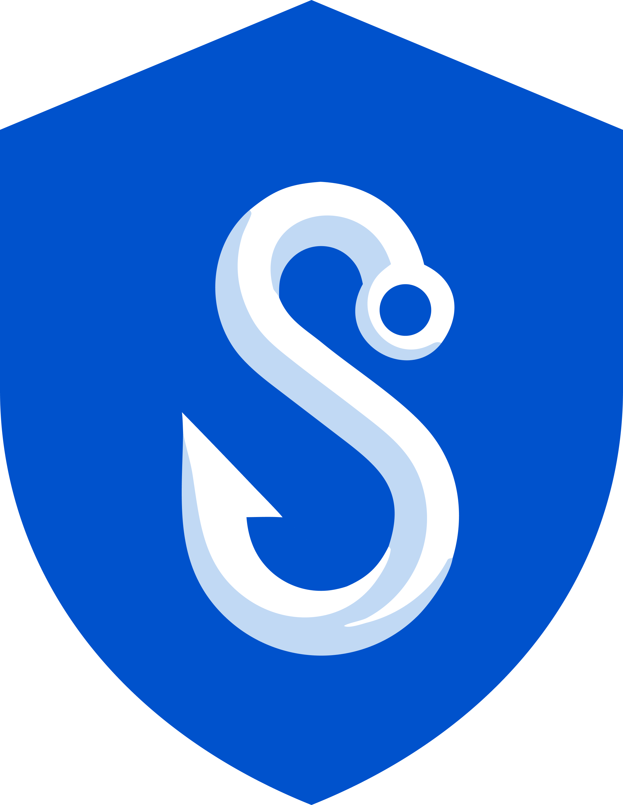

# Singularity AIDR

**AI Agent Detection & Response (AIDR)** — a security layer for AI agents and AI
chat. AIDR inspects the commands, files and web requests of AI coding agents before
the host acts on them, and masks personal data and secrets before prompts reach AI
chat products.

  

Singularity AIDR intercepts tool calls (Bash commands, URL fetches, file writes) via hook systems in [Claude Code](docs/platform-guides/claude-code.md), [OpenClaw](docs/platform-guides/openclaw.md), [OpenCode](docs/platform-guides/opencode.md), [Codex](docs/platform-guides/codex.md) and [Cursor / VS Code](docs/platform-guides/cursor.md) (preview — no real-host acceptance evidence yet), and checks them against the rules below. Claude Code, Cursor, VS Code, OpenClaw and OpenCode are the intended first general-availability scope; Codex is a preview outside it. No connector has completed real-host acceptance across the sold platform matrix (see Release status below).

Each tool call is checked against:

- **Local heuristics** — 519 YAML threat rules in 31 files ([`threats/`](threats/)) for
  dangerous commands, credential access, persistence, obfuscation, supply-chain and
  LLM-specific patterns on Linux, macOS and Windows
- **Package supply-chain checks** — an offline typosquat check for npm/PyPI names, plus
  registry existence, file reputation and age analysis when `package_check` is enabled
- **Plugin scanning** — scans other installed plugins for threats at session start
- **Reputation checks** — first-party URL/domain and package hash lookups (optional; they
  need a configured endpoint and are never reported as "clean" when unavailable)

## Product lines

| Product line | What it does | Start here |
| --- | --- | --- |
| **AIDR for AI coding agents** | Connectors for Claude Code, OpenClaw and OpenCode, plus Cursor and VS Code as a preview and Codex CLI as a preview outside the first GA scope, share one local decision engine that returns `allow`, `deny` or `ask`. Tested host versions are in the [compatibility matrix](docs/compatibility-matrix.md). The [MCP Gateway](packages/mcp-gateway/README.md) inspects MCP tool results before they reach a model, the [SDK](packages/sdk/README.md) adds the same checks to your own applications, and the [CLI](packages/cli/) handles setup, status and AI-infrastructure scans. | [Product overview](docs/product/overview.md) |
| **AIDR Browser Guard** | Chrome, Edge and Firefox extension. Masks Turkish and English personal data (T.C. kimlik numbers, IBANs, phone numbers, email addresses, card numbers), secrets and API keys, custom terms and exact-data-match fingerprints before prompts, pastes and files reach ChatGPT, Gemini, Claude, Copilot, Perplexity, DeepSeek, Mistral or Grok. Placeholders such as `[EMAIL_1]` are restored locally in the response. Supports administrator-managed policy and counts-only telemetry. Tested against hermetic copies of these sites, not yet on the live sites; not yet published in the browser stores. | [Browser Guard](packages/browser-guard/README.md) |
| **AIDR Privacy engine** | TR/EN detection and masking with checksum validation, used by Browser Guard, and an optional enterprise gateway. The endpoint native host for NER/OCR ships without a model and is not part of the first-release support scope. | [AIDR Privacy](packages/privacy/README.md) |
| **AI Security Posture** | Finds weak spots in the AI stack around your agents. `aidr scan --target` fingerprints AI services (146 AI component fingerprints) and matches their versions against 2,000+ CVE rules, with severity and CVSS. `aidr discover` inventories local MCP servers and maps them to 14 MCP risk categories. `aidr scan --skill` and the session-start plugin scan check skills and plugins against the T01–T09 taxonomy. Findings can be uploaded to the dashboard's Security posture page as identifiers and digests only; target URLs, file paths and matched text stay on the machine. | [AI Security Posture](docs/ai-security-posture.md) |

## Deployment options

| Option | Summary | Guide |
| --- | --- | --- |
| **Local detection (no account)** | Every connector evaluates every tool call on the device; detection needs no account, enrollment or network. Signed release builds are managed-only and need the release trust key before first start (the Windows/Linux installers set it up; a manual install runs `aidr setup --release-key <file.pem>`), but detect locally before enrollment. Browser Guard masks prompts in the browser. | [Configuration](docs/configuration.md), [Integrity](docs/integrity.md) |
| **Cloud (SaaS)** | Hosted control plane: dashboard, device enrollment, central policy, audit export, SSO/SCIM. Local enforcement keeps working if the service is unreachable or the entitlement lapses; only managed features stop. **Not live yet:** the app hostname does not resolve, no EU, US or APAC region is deployed, and there is no hosted console to sign in to. | [SaaS deployment](docs/deployment/saas.md) |
| **On-premises** | Customer-operated control plane on Docker Compose or Kubernetes (Helm; not yet run on a live cluster), including an air-gapped path with a signed offline license and signed rule/intel packs. A Compose installation upgrades with one command (`pnpm onprem:upgrade --to <new release directory>`: backup, checks, upgrade, health check). | [On-prem deployment](docs/deployment/onprem.md), [Upgrading](docs/operations/onprem-upgrade.md) |

## Plans

Free, **Team** (minimum 3 developers), **Business** (minimum 25
developers) and **Enterprise** (on-premises and air-gapped). Pricing is by written quote
through anil@singularityrd.com; self-service checkout is not enabled. Edition contents
are listed in the [product catalog](docs/sales/catalog/README.md).

## Quick start

**Zero to protected in one page:** [Quickstart (English)](docs/quickstart.md) ·
[Hızlı başlangıç (Türkçe)](docs/quickstart.tr.md). It covers a developer laptop (Windows
or Linux installer from the dashboard **Downloads** page, then `aidr status` and
`aidr verify`; `aidr update` keeps it current), an office user (Browser Guard from the
browser stores), the IT admin (silent install, Browser Guard force-install or self-hosted
updates, approvals with `aidr approve <first 8 characters of the id>`) and on-prem. macOS
installers are not offered. The quickstart describes the flow once a signed release is
published: today no signed installer, Downloads page or browser-store listing has been
published to customers, and there is no hosted dashboard. The installers are command-line
and hook installers; there is no AIDR desktop application. All guides by role:
[Installation guides](docs/installation/README.md).

The connector-by-connector path below is for hosts and systems the desktop installers do
not cover, such as macOS. Install only a signed, approved release (see [Release status](#release-status)). Source
builds are for development.

1. **Provision the release trust key first.** Release builds are managed-only and verify
   their signed artifacts before inspecting anything. Run
   `aidr setup --release-key <file.pem>` with the independently distributed Ed25519
   public key; it writes `integrity.public_keys_pem` in `~/.singularity-aidr/config.json`
   (Windows `%USERPROFILE%\.singularity-aidr\config.json`), as described in
   [Integrity verification](docs/integrity.md). Without it the connector blocks every tool
   call and says why ("cannot verify its own installation (release verification key
   missing)").
2. **Install the connector** for your runtime (below). Local detection is active as soon as
   it is installed, before any enrollment.
3. **Optionally enroll** for managed features; they need a control plane and a signed
   tenant configuration.

Check the [compatibility matrix](docs/compatibility-matrix.md) for the tested host
versions, and the [upgrade notes](docs/upgrade-notes.md) when moving between releases.

| Runtime | Install |
| --- | --- |
| **Claude Code** | Extract the signed `aidr-claude-plugin-<version>.tar.gz`, then run `/plugin marketplace add /absolute/path/to/extracted/aidr-claude-plugin` and `/plugin install aidr@aidr`. Requires Node.js >= 22.12.0. [Guide](docs/platform-guides/claude-code.md) |
| **Cursor / VS Code** (preview — no real-host acceptance evidence yet) | Install the signed `aidr-cursor.vsix` (Cursor) or `aidr-vscode.vsix` (VS Code) via `Extensions > Install from VSIX`, then run `Singularity AIDR: Enable protection`. No Cursor or VS Code version has been accepted on a real host. [Guide](docs/platform-guides/cursor.md) |
| **OpenClaw** | Install the approved `@singularityrd/aidr-openclaw` version from the private registry. [Guide](docs/platform-guides/openclaw.md) |
| **OpenCode** | Install the approved `@singularityrd/aidr-opencode` version from the private registry. [Guide](docs/platform-guides/opencode.md) |
| **Codex CLI** | Install `@singularityrd/aidr-codex`, register `aidr-codex-hook` as a `PreToolUse` and a `UserPromptSubmit` (prompt protection) hook and trust both with `/hooks`. [Guide](docs/platform-guides/codex.md) |
| **MCP Gateway** | Run the loopback gateway with a signed configuration and point MCP clients at it. [Gateway README](packages/mcp-gateway/README.md) |
| **Browser Guard** | Not yet published: no Chrome Web Store / Edge Add-ons listing or Mozilla-signed XPI exists today, so evaluations load the built extension unpacked. Once published, install from the unlisted Chrome Web Store / Edge Add-ons listings (the stores keep it updated) or the Mozilla-signed Firefox XPI, or push it with enterprise browser policy using [`managed_schema.json`](packages/browser-guard/static/managed_schema.json); networks without store access host the signed package and its update feed themselves. [Browser Guard](packages/browser-guard/README.md), [enterprise deployment](docs/installation/browser-guard-enterprise.md) |
| **CLI** | `aidr setup` (detects the installed AI tools and installs or updates their connectors; `--dry-run` to preview; `--release-key <file.pem>` for a manual install; exit code `3` = no AI tool found yet), `aidr status`, `aidr verify` (harmless canary through each hook: PASS / FAIL / SKIP), `aidr doctor` (`--verbose` explains each check), `aidr pending` / `aidr approve [id]` (first 8 characters of the id, or a numbered pick), `aidr update` (installer endpoints; `update.auto`), `aidr uninstall`, `aidr scan --target <url>`. [Package Installation](docs/package-installation.md) |

Private registry credentials and versioned setup are in
[Package Installation](docs/package-installation.md); the full flow is in
[Getting Started](docs/getting-started.md).

> **Managed enrollment requires a deployed and live-accepted control plane.** Without
> one the product runs in local mode and managed features are unavailable; local
> detection is unaffected. See [Configuration](docs/configuration.md) for the `mode`
> setting (`local` default, `managed` opt-in).

## How failures are handled

- **Connector entry points fail closed.** Claude Code, Cursor/VS Code, OpenClaw,
  OpenCode and Codex return a deny on an internal error. A host that never invokes the
  hook (disabled, removed or untrusted), or kills or times out the hook process, can still
  proceed: Claude Code was observed to run the call when its hook was disabled or killed,
  Codex runs it when its hook is untrusted, crashes or times out, and Cursor/VS Code
  behaviour has not been observed on a real host. Per-host results are in
  the [compatibility matrix](docs/compatibility-matrix.md#host-failure-behaviour).
- **Detection internals** skip a failing signal, log it and continue. A skipped signal
  is never reported as a clean result.
- **Security controls** (authentication, tenant isolation, approvals, webhook signatures)
  fail closed. `ask` blocks pending an out-of-band human approval; no connector gives the
  agent an approval tool.

## Release status

**Production decision on 10 October 2026: NO-GO.** The consolidated source has
20 verified open code findings (14 P1 and 6 P2), additional implementation and
field-acceptance gaps, and 13 open acceptance gates (12 for production; INV-001
also applies to investor claims). The [complete open-gap record](docs/audit/production-gaps-2026-10-10.md)
lists all 40 numbered items, their evidence, proposed fixes and closure criteria.
These findings have not been resolved by merging branches or publishing this record.

Singularity AIDR is **not yet released for customer or production use**. Connectors,
Browser Guard and the control plane are implemented and tested in this repository, but
signed-candidate evidence, real-host acceptance, an independent security review and
commercial approvals are still open. Read the
[first-customer readiness profile](docs/production-readiness/first-customer-ready.md)
before offering an installation. Capability status is in
[FEATURE_INVENTORY.md](FEATURE_INVENTORY.md) and the remaining work in the
[production and sales gap audit](PRODUCTION_SALES_GAPS.md). Local test passes do not
replace signed-candidate or live-host acceptance.

## Documentation

| Document | Description |
| --- | --- |
| [Product overview](docs/product/overview.md) | Product lines, architecture and boundaries |
| [Getting Started](docs/getting-started.md) | Installation for supported runtimes |
| [Compatibility matrix](docs/compatibility-matrix.md) | Tested host versions, platforms, interception points, host failure behaviour |
| [Upgrade notes](docs/upgrade-notes.md) | What to do and what changes when upgrading |
| [Package Installation](docs/package-installation.md) | Private registry installs and prerequisites |
| [How It Works](docs/how-it-works.md) | Detection layers, data flow, verdicts |
| [Configuration](docs/configuration.md) | All config options and file paths |
| [Threat Rules](docs/threat-rules.md) | YAML rule format and what gets checked |
| [Package Protection](docs/package-protection.md) | npm/PyPI supply-chain checks |
| [Plugin Scanning](docs/plugin-scanning.md) | Session-start plugin scanning |
| [AMSI Scanning](docs/amsi-scanning.md) | Windows antimalware scanning via AMSI |
| [Privacy](docs/privacy.md) | What data is sent, what stays local |
| [Architecture](docs/architecture.md) | Monorepo structure, packages, design decisions |
| [Control Plane](docs/control-plane.md) | Auth, dashboard and licensing |
| [Device Auth](docs/device-auth.md) | Browser-based device authorization |
| [SaaS deployment](docs/deployment/saas.md) · [On-prem deployment](docs/deployment/onprem.md) | Deployment options |
| [Security FAQ](docs/sales/security-faq.md) | Data flows, tenancy, identity, audit, retention |
| [One-pager](docs/sales/one-pager.md) · [Competitive notes](docs/sales/competitive.md) · [Demo script](docs/sales/demo-script.md) | Sales collateral |
| [Pilot Program](docs/pilot-program.md) | Current pilot status and application prerequisites |
| [Development](docs/development.md) | Building, testing, tooling, conventions |
| [FAQ](docs/faq.md) | Common questions |

**Platform guides:** [Claude Code](docs/platform-guides/claude-code.md) · [Cursor / VS Code](docs/platform-guides/cursor.md) · [OpenClaw](docs/platform-guides/openclaw.md) · [OpenCode](docs/platform-guides/opencode.md) · [Codex](docs/platform-guides/codex.md)

## Current limitations

- MCP tool call interception (`mcp__*`) in the agent connectors is best-effort via
  generic input scanning; the [MCP Gateway](packages/mcp-gateway/README.md) covers only
  clients routed through it.
- Remote URL and file reputation checks require configured services and feeds.
  Unavailable checks are not reported as "clean". With the reputation legs off (the
  default), URL fetches and package installs are decided by the local rules and the
  offline typosquat check and recorded as "not checked"; `unchecked_action: "ask"`
  holds them for review instead ([Configuration](docs/configuration.md#url_check)).
- An expired or invalid license/entitlement switches managed features off; local
  detection keeps enforcing in every build ([Licensing](docs/operations/licensing.md)).
- The [Codex connector](docs/platform-guides/codex.md) covers `Bash` and `apply_patch`
  calls; Codex can fail open when a hook process is unavailable. This is not endpoint
  isolation.
- Browser Guard works on the listed AI sites through per-site adapters; a site redesign
  can require an adapter update. The adapters are verified against hermetic fixture
  copies of the sites in a real browser, not yet against the live sites. Names and addresses without a cue word need the
  optional native NER host, which ships without model weights.
- Custom user threat definitions are supported via `~/.singularity-aidr/threats/*.yaml`
  (override by `id`).

## Privacy

Local heuristics do not upload source code or file contents. If enabled, URL reputation
sends each URL, including its host and path, to the configured endpoint; package checks
may send package names, versions and registry metadata, and file checks send SHA-256
hashes. Browser Guard detection runs in the browser; its optional telemetry sends
per-type counts, never text or values. See [Privacy](docs/privacy.md).

## Contributing

See [CONTRIBUTING.md](CONTRIBUTING.md) for development setup, coding conventions, and the
threat rule contribution process.

## Closed-Source / Commercial Builds

For commercial/closed-source distribution, use `pnpm build:release`. Release builds
intentionally **omit sourcemaps** (`.map`) and `sourceMappingURL` references to reduce
source leakage.

## License

Copyright 2026 SingularityRD.

- First-party AIDR source code and release artifacts: proprietary commercial terms in [LICENSE](LICENSE). Legal approval of the current Release Candidate is still required before customer distribution.
- Threat detection rules (`threats/`): [Detection Rule License 1.1](threats/LICENSE)
- Third-party component notices: [THIRD_PARTY_NOTICES](THIRD_PARTY_NOTICES). Those components retain their original licence terms.
