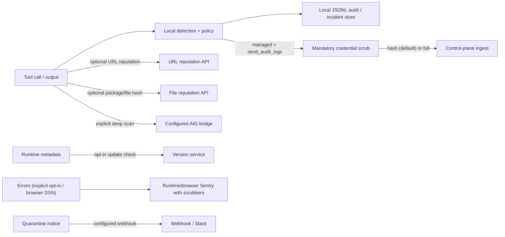

# Privacy and telemetry data flow

This page describes the data boundary implemented by the runtime. It is an
engineering statement, not a DPA or a legal determination. A customer pilot
must still record the actual destination, region, retention, subprocessors and
lawful basis for every enabled sink.

## Default posture

Detection and policy evaluation run locally. Local heuristics do not upload
source files or full prompts. Enabled reputation checks, managed telemetry,
deep scans, diagnostics and operator-configured notifications have separate
outbound paths. An unavailable reputation check is reported as incomplete
inspection and can require review; it is not treated as a clean result.
In source/development defaults, URL, file and package reputation checks are
disabled; enabling them opts into the separate outbound flows below. Automatic
version checks are also disabled by default. See [Configuration](configuration.md)
for the executable defaults and options.



## What can leave the process

1. **URL reputation** — when `url_check.enabled` is true, URLs extracted from
   tool calls are sent to the configured reputation API. Disable this feature
   for an offline or customer-controlled deployment.
2. **File/package reputation** — package names, versions, registry metadata
   and file hashes (SHA-256) may be sent to package registries and the
   configured reputation service; file contents are not uploaded by this leg.
3. **Version check** — automatic startup/extension checks require
   `version_check.enabled: true`. They send version, agent runtime/version,
   OS/version/architecture and a random installation ID; an enrolled runtime
   may also send its API key as an Authorization header. Direct callers of
   `checkForUpdate()` are separate. The installation ID is persisted at
   `~/.singularity-aidr/installation-id`.

   An endpoint installed with the Windows/Linux desktop installers instead
   checks the signed installer catalog (`update.auto`, default `notify`; at
   most once per `update.check_interval_hours`). It contacts only the
   tenant's own control plane (managed mode, Authorization: the device's API
   key; no runtime metadata or installation ID in the request) or the
   configured `update.source` mirror. Device-managed machines and
   `update.auto: "off"` make no such request.
4. **Managed control plane** — only when managed mode, control-plane sync and
   an API key are configured. Runtime verdict events cross a mandatory
   credential redaction boundary. The default `redact_mode: "hash"` replaces
   tool summaries and artifacts with SHA-256 digests; `"full"` omits them. A
   configured `"none"` mode still strips bearer credentials, API keys, JWTs,
   URL credentials and secret query parameters, but is not recommended for
   production because ordinary command/URL text can remain.
5. **Diagnostics** — Node runtimes that initialize core Sentry send events
   only when `SENTRY_ENABLED=true` (or `1`) **and** a real `SENTRY_DSN` are set;
   DSN alone does not opt in. Blank/placeholder DSNs do not enable default
   runtime telemetry. The dashboard browser has a separate configuration: it
   initializes Sentry only with a configured runtime/build-time DSN;
   its tracing sample rate defaults to zero. Events, exceptions, URLs, context
   and breadcrumbs are scrubbed, but arbitrary prose still needs customer
   review. `sendDefaultPii` is false. The Cursor and VS Code extensions do
   not initialize Sentry; their verdict evidence remains in the host UI/logs
   and local audit trail.
6. **AIG deep scan** — an explicit scan sends the target and options to the
   configured AIG bridge (loopback by default). A target can contain full
   user-controlled text; verify where that bridge runs before using it with
   customer data.
7. **Response notifications** — when configured, quarantine webhooks/Slack
   alerts can send identifiers, original file paths, hashes and threat IDs to
   the chosen destination.

The outbound control-plane client also applies the redaction boundary itself,
so callers cannot accidentally bypass it by constructing an event directly.

### Browser Guard privacy telemetry

Browser Guard (the browser extension that masks sensitive data before it
reaches AI chat products) reports to the control plane only after it is enrolled
with a control-plane URL and tenant API key. It sends one `privacy_scan` event
per guarded send, as defined in
[`docs/contracts/privacy-telemetry.md`](contracts/privacy-telemetry.md):

- the AI site as an enum (`chatgpt`, `gemini`, `claude`, `copilot`,
  `perplexity`, `deepseek`, `mistral`, `grok`, `other`), never a URL;
- what the guard did (`masked`, `warned`, `blocked`, `allowed`) and the channel
  (`prompt`, `paste`, `file`);
- per-entity-type counts (for example `{"EMAIL": 2, "TC_KIMLIK": 1}`), the total
  findings count and an optional policy identifier;
- a random per-install ID, the browser family/major version and the extension
  version.

No prompt text, masked text, placeholder values or matched values are sent.
The server does not rely on the client for this: the ingest projection keeps
only the fields above, drops unknown entity types and out-of-range counts, and
discards any other field. Placeholder originals stay in the browser: in the
tab's memory and the browser's memory-backed session storage for that tab
(removed when the tab closes or after 4 hours idle), never on disk or the
network. Privacy scans are stored as tenant telemetry
(`public.events`), so they follow the tenant's telemetry retention policy, legal
holds and offboarding deletion. Masking works without enrollment; an
unreachable control plane only delays reporting (the extension keeps a bounded
local queue of at most 500 counts-only events and drops the oldest).

## What stays local

- Source code, file contents and full tool input used by local heuristics stay
  in-process unless an explicit outbound feature sends a derived or selected
  value as described above. Full URLs and AIG scan targets are not inherently
  anonymous.
- Heuristic/threat matching and policy decisions.
- Verdict cache, allowlist and local audit/incident records.
- Node Sentry is disabled without explicit `SENTRY_ENABLED=true` (or `1`)
  and a real DSN. Browser Sentry is disabled without its configured DSN; the
  Cursor and VS Code extensions do not initialize it.

Local logs can still contain security evidence. They are protected by local
filesystem permissions, should be treated as confidential, and must not be
copied into support tickets without review.

## Local audit retention and deletion semantics

The runtime JSONL logger defaults to a 5 MiB active file and three rotated
backups. The legacy `AuditLogConfig` helper additionally supports age-based
cleanup (30 days, 50 MiB and five backups by default), but age cleanup is not
implicitly enabled by the runtime evaluator. Configure the active logger in
`~/.singularity-aidr/config.json`:

```json
{
  "logging": {
    "enabled": true,
    "path": "~/.singularity-aidr/audit.jsonl",
    "max_bytes": 5242880,
    "max_files": 3
  },
  "control_plane": {
    "send_audit_logs": false,
    "redact_mode": "full"
  }
}
```

`ResponseAuditor` provides an optional tamper-evident mode with
`{ signEntries: true }`. In that mode:

- each entry contains a SHA-256 hash chained to the previous entry and an
  Ed25519 signature;
- `<audit-file>.head` records the latest signed hash, allowing tail deletion
  to be detected when the checkpoint is present;
- retention purges write signed deletion evidence to
  `<audit-file>.retention.jsonl` before replacing the active file; and
- malformed lines, invalid signatures, missing head checkpoints and head
  mismatches fail integrity verification.

This is tamper-evident, not an independent immutable archive. An attacker who
can delete both the log and its checkpoint can erase local evidence. Production
customers must export the signed records/head/deletion manifest to an
independent append-only store with controlled key custody and tested restore.
Explicit deletion of the local files is destructive; the runtime does not
promise recovery after filesystem deletion.

## Offline configuration

Disable optional reputation and managed telemetry for a fully local pilot:

```json
{
  "url_check": { "enabled": false },
  "file_check": { "enabled": false },
  "package_check": { "enabled": false },
  "version_check": { "enabled": false },
  "update": { "auto": "off" },
  "control_plane": {
    "enabled": false,
    "send_audit_logs": false
  }
}
```

For a source/development build, leave `SENTRY_ENABLED` unset/false and
`SENTRY_DSN` unset, and leave the dashboard's browser Sentry DSN unset; do not
configure AIG remote scans or notification
webhooks. Commercial builds force managed mode and cannot use this as an
offline bypass. Verify the effective configuration and outbound network policy
in the customer environment; this document does not replace that evidence.

## Content privacy engine (AIDR Privacy)

The telemetry boundary above is separate from *content* privacy: detecting and
masking personal data and secrets inside prompts, tool inputs and outputs. That
engine is the workspace package `@singularityrd/aidr-privacy`
([`packages/privacy`](../packages/privacy/README.md)), which provides Turkish and
English detection with checksum validation (T.C. kimlik, IBAN mod-97, Luhn),
Turkish phone/address/labelled-field rules and provider-token/private-key
patterns.

- **Browser Guard** imports its browser-safe rule layer directly; detection runs
  in the browser and nothing is uploaded for inspection.
- **Core DLP** uses a generated, drift-checked copy of the same rule files, so
  every agent connector applies the same TR/EN detectors locally.
- **CLI privacy scan** (`aidr privacy scan [file]`, `packages/cli`) applies the
  same core detectors, plus the credential detector used for tool-output
  quarantine, to one local file or standard input (up to 4 MiB of UTF-8 text).
  It reports type, offsets and line numbers (never the matched value), can print
  a `[TYPE]`-masked copy with `--mask`, and exits `3` rather than reporting an
  incompletely inspected input as clean. It runs on the operator's machine and
  is not an upload path.
- The **enterprise gateway / control plane** (`/platform`), enterprise policy
  (`/enterprise`) and the Chrome native-messaging host are optional building
  blocks. They are not enabled by installing AIDR and need customer IdP/MDM and
  provider brokers before they can be accepted. See the
  [feature status](../packages/privacy/docs/PLATFORM_FEATURE_STATUS.en.md)
  (English summary of the Turkish original).

Masking is lossy (`[EMAIL]`-style labels or `[REDACTED]`); the optional token
mode is a one-way HMAC and cannot be reversed. Learned PERSON/ADDRESS NER is
not bundled and not sold in the first release (no model ships), so contextual rules are the only name/address signal unless a
customer supplies an approved model. Run `pnpm test:privacy` to build the
package and execute its Node suites; tests needing an unavailable Python,
libseccomp or OpenSSL prerequisite are reported as named skips.

## Pilot evidence still required

Before a customer or investor demo, attach the destination inventory,
diagnostic retention and access settings, DPA/subprocessor review, regional
routing, key-rotation/custody procedure, deletion/DSAR procedure and an
independent restore test for signed audit evidence.
