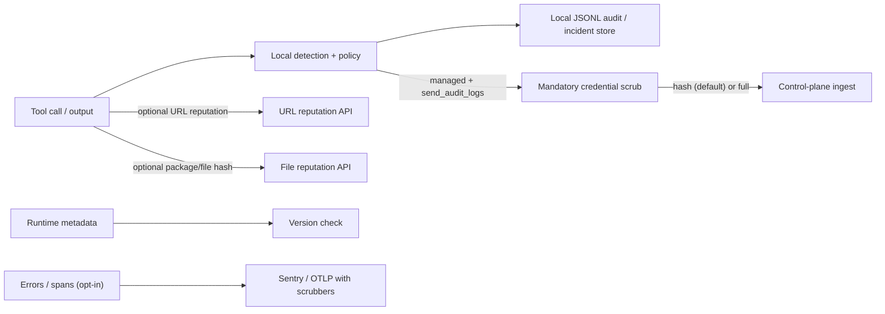

# Privacy and telemetry data flow

This page describes the data boundary implemented by the runtime. It is an
engineering statement, not a DPA or a legal determination. A customer pilot
must still record the actual destination, region, retention, subprocessors and
lawful basis for every enabled sink.

## Default posture

Detection and policy evaluation run locally. Source files, file contents and
full prompts are not sent to a remote sink by the local evaluator. Optional
network features are independently configurable and fail open when a remote
service is unavailable.



## What can leave the process

1. **URL reputation** — when `url_check.enabled` is true, URLs extracted from
   tool calls are sent to the configured reputation API. Disable this feature
   for an offline or customer-controlled deployment.
2. **File/package reputation** — package/file hashes (SHA-256) and registry
   metadata may be sent for reputation checks; file contents are not uploaded.
3. **Version check** — version, agent runtime/version, OS/architecture and a
   random installation ID may be sent. The installation ID is persisted at
   `~/.singularity-aidr/installation-id`.
4. **Managed control plane** — only when managed mode, control-plane sync and
   an API key are configured. Runtime verdict events cross a mandatory
   credential redaction boundary. The default `redact_mode: "hash"` replaces
   tool summaries and artifacts with SHA-256 digests; `"full"` omits them. A
   configured `"none"` mode still strips bearer credentials, API keys, JWTs,
   URL credentials and secret query parameters, but is not recommended for
   production because ordinary command/URL text can remain.
5. **Sentry** — only when `SENTRY_DSN` and `SENTRY_ENABLED` permit it. Event
   messages, exception values/stacks, request URLs/query strings, context,
   tags and user PII are scrubbed before send. An anonymous installation ID
   may be used for event grouping; `sendDefaultPii` is not enabled.
6. **OpenTelemetry/OTLP** — only when `TRACE_ENABLED=true` and an OTLP
   endpoint is configured. Span attributes/events/exceptions are scrubbed;
   endpoint credentials, query strings and fragments are removed before the
   exporter is created. W3C trace context contains identifiers, not payloads.

The outbound control-plane client also applies the redaction boundary itself,
so callers cannot accidentally bypass it by constructing an event directly.

## What stays local

- Source code, file contents and full tool input used by the detector.
- Heuristic/threat matching and policy decisions.
- Verdict cache, allowlist and local audit/incident records.
- Sentry/OTLP are disabled unless explicitly configured.

Local logs can still contain security evidence. They are protected by local
filesystem permissions, should be treated as confidential, and must not be
copied into support tickets without review.

## Local audit retention and deletion semantics

The runtime JSONL logger defaults to a 5 MiB active file and three rotated
backups. The legacy `AuditLogConfig` helper additionally supports age-based
cleanup (30 days, 50 MiB and five backups by default), but age cleanup is not
implicitly enabled by the runtime evaluator. Configure the active logger in
`~/.singularity-aidr/config.json`:

```json
{
  "logging": {
    "enabled": true,
    "path": "~/.singularity-aidr/audit.jsonl",
    "max_bytes": 5242880,
    "max_files": 3
  },
  "control_plane": {
    "send_audit_logs": false,
    "redact_mode": "full"
  }
}
```

`ResponseAuditor` provides an optional tamper-evident mode with
`{ signEntries: true }`. In that mode:

- each entry contains a SHA-256 hash chained to the previous entry and an
  Ed25519 signature;
- `<audit-file>.head` records the latest signed hash, allowing tail deletion
  to be detected when the checkpoint is present;
- retention purges write signed deletion evidence to
  `<audit-file>.retention.jsonl` before replacing the active file; and
- malformed lines, invalid signatures, missing head checkpoints and head
  mismatches fail integrity verification.

This is tamper-evident, not an independent immutable archive. An attacker who
can delete both the log and its checkpoint can erase local evidence. Production
customers must export the signed records/head/deletion manifest to an
independent append-only store with controlled key custody and tested restore.
Explicit deletion of the local files is destructive; the runtime does not
promise recovery after filesystem deletion.

## Offline configuration

Disable optional reputation and managed telemetry for a fully local pilot:

```json
{
  "url_check": { "enabled": false },
  "file_check": { "enabled": false },
  "control_plane": {
    "enabled": false,
    "send_audit_logs": false
  }
}
```

Also leave `SENTRY_DSN` unset and `TRACE_ENABLED` unset/false. Verify the
effective configuration and outbound network policy in the customer
environment; this document does not replace that evidence.

## Pilot evidence still required

Before a customer or investor demo, attach the destination inventory,
Sentry/OTLP retention and access settings, DPA/subprocessor review, regional
routing, key-rotation/custody procedure, deletion/DSAR procedure and an
independent restore test for signed audit evidence.
