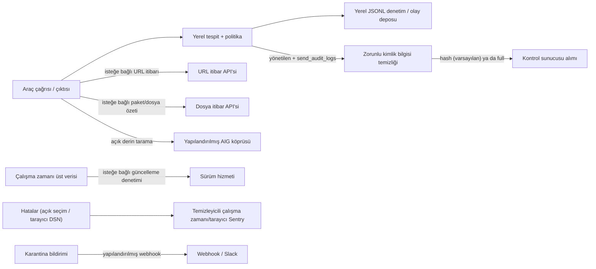

# Gizlilik ve telemetri veri akışı

[English](privacy.md) · Bu sayfa İngilizce [privacy.md](privacy.md) belgesinin
Türkçesidir; iki metin ayrışırsa İngilizce sürüm kaynak koda daha yakındır ve
önce o güncellenir.

Bu sayfa, çalışma zamanının uyguladığı veri sınırını anlatır. Bir mühendislik
beyanıdır; veri işleme sözleşmesi (DPA) ya da hukuki bir değerlendirme değildir.
Bir müşteri pilotunda, açılan her hedef için gerçek hedef, bölge, saklama
süresi, alt işleyenler ve hukuki sebep yine ayrıca kayda geçirilmelidir.
Kurumlar için KVKK rehberi: [operations/kvkk.md](operations/kvkk.md).

## Varsayılan durum

Tespit ve politika değerlendirmesi yerelde çalışır. Yerel sezgisel denetimler
kaynak dosyaları ya da tam istemleri yüklemez. Açılan itibar sorguları,
yönetilen telemetri, derin taramalar, tanılama ve operatörün yapılandırdığı
bildirimlerin her birinin ayrı bir dışa giden yolu vardır. Ulaşılamayan bir
itibar sorgusu eksik inceleme olarak bildirilir ve incelemeye bırakılabilir;
temiz sonuç sayılmaz. Kaynak/geliştirme varsayılanlarında URL, dosya ve paket
itibar sorguları kapalıdır; açmak aşağıdaki ayrı dış akışları seçmek demektir.
Otomatik sürüm denetimi de varsayılan olarak kapalıdır. Çalışan varsayılanlar ve
seçenekler için [Yapılandırma](configuration.md) sayfasına bakın.



## Süreçten neler çıkabilir

1. **URL itibarı** — `url_check.enabled` true olduğunda, araç çağrılarından
   çıkarılan URL'ler yapılandırılmış itibar API'sine gönderilir. Çevrimdışı ya
   da müşteri denetimindeki bir kurulumda bu özelliği kapatın.
2. **Dosya/paket itibarı** — paket adları, sürümleri, kayıt (registry) üst
   verisi ve dosya özetleri (SHA-256) paket kayıtlarına ve yapılandırılmış
   itibar hizmetine gidebilir; bu yol dosya içeriğini yüklemez.
3. **Sürüm denetimi** — otomatik açılış/eklenti denetimleri
   `version_check.enabled: true` ister. Sürüm, ajan çalışma ortamı/sürümü,
   işletim sistemi/sürüm/mimari ve rastgele bir kurulum kimliği gönderilir;
   kayıtlı bir çalışma zamanı API anahtarını Authorization başlığında da
   gönderebilir. `checkForUpdate()` fonksiyonunu doğrudan çağıranlar ayrıdır.
   Kurulum kimliği `~/.singularity-aidr/installation-id` dosyasında saklanır.

   Windows/Linux masaüstü kurulum paketleriyle kurulan bir uç nokta bunun
   yerine imzalı kurulum kataloğunu denetler (`update.auto`, varsayılan
   `notify`; en fazla `update.check_interval_hours` başına bir kez). Yalnız
   kiracının kendi kontrol sunucusuna (yönetilen mod, Authorization: cihazın
   API anahtarı; istekte çalışma zamanı üst verisi ya da kurulum kimliği yok)
   ya da yapılandırılmış `update.source` aynasına bağlanır. Cihaz yönetimli
   makineler ve `update.auto: "off"` böyle bir istek yapmaz.
4. **Yönetilen kontrol sunucusu** — yalnız yönetilen mod, kontrol sunucusu
   eşitlemesi ve bir API anahtarı yapılandırıldığında. Karar olayları zorunlu
   bir kimlik bilgisi temizleme sınırından geçer. Varsayılan
   `redact_mode: "hash"` araç özetlerini ve eserleri SHA-256 özetleriyle
   değiştirir; `"full"` onları hiç göndermez. `"none"` seçilse bile bearer
   kimlik bilgileri, API anahtarları, JWT'ler, URL içindeki kimlik bilgileri ve
   gizli sorgu parametreleri çıkarılır; ancak sıradan komut/URL metni
   kalabileceğinden üretimde önerilmez.
5. **Tanılama** — çekirdek Sentry'yi başlatan Node çalışma zamanları, yalnız
   `SENTRY_ENABLED=true` (ya da `1`) **ve** gerçek bir `SENTRY_DSN`
   tanımlandığında olay gönderir; DSN tek başına yetmez. Boş ya da yer tutucu
   DSN varsayılan telemetriyi açmaz. Panelin tarayıcı tarafının ayrı bir
   yapılandırması vardır: Sentry'yi yalnız yapılandırılmış bir çalışma
   zamanı/derleme DSN'i ile başlatır; izleme örnekleme oranı varsayılan
   sıfırdır. Olaylar, istisnalar, URL'ler, bağlam ve iz kırıntıları temizlenir;
   ancak serbest metin yine müşteri incelemesi gerektirir. `sendDefaultPii`
   false'tur. Cursor ve VS Code eklentileri Sentry başlatmaz; karar kanıtları
   araç arayüzünde/günlüklerinde ve yerel denetim kaydında kalır.
6. **AIG derin tarama** — açık bir tarama komutu hedefi ve seçenekleri
   yapılandırılmış AIG köprüsüne gönderir (varsayılan loopback). Hedef,
   kullanıcının yazdığı tam metni içerebilir; müşteri verisiyle kullanmadan önce
   köprünün nerede çalıştığını doğrulayın.
7. **Yanıt bildirimleri** — yapılandırıldığında karantina webhook'ları/Slack
   uyarıları kimlikleri, özgün dosya yollarını, özetleri ve tehdit
   kimliklerini seçilen hedefe gönderebilir.

Dışa giden kontrol sunucusu istemcisi temizleme sınırını kendisi de uygular;
böylece bir olayı doğrudan oluşturan kod bu sınırı yanlışlıkla atlayamaz.

### Browser Guard gizlilik telemetrisi

Browser Guard (AI sohbet ürünlerine ulaşmadan önce hassas veriyi maskeleyen
tarayıcı eklentisi), kontrol sunucusuna yalnız bir kontrol sunucusu adresi ve
kiracı API anahtarıyla kaydedildikten sonra bildirim yapar. Korunan her gönderim
için [`docs/contracts/privacy-telemetry.md`](contracts/privacy-telemetry.md)
belgesinde tanımlanan bir `privacy_scan` olayı gönderir:

- AI sitesi bir sabit değer olarak (`chatgpt`, `gemini`, `claude`, `copilot`,
  `perplexity`, `deepseek`, `mistral`, `grok`, `other`), asla URL olarak değil;
- korumanın ne yaptığı (`masked`, `warned`, `blocked`, `allowed`) ve kanal
  (`prompt`, `paste`, `file`);
- varlık türü başına sayılar (örneğin `{"EMAIL": 2, "TC_KIMLIK": 1}`), toplam
  bulgu sayısı ve isteğe bağlı bir politika kimliği;
- kurulum başına rastgele bir kimlik, tarayıcı ailesi/ana sürümü ve eklenti
  sürümü.

İstem metni, maskelenmiş metin, yer tutucu değerleri ya da eşleşen değerler
gönderilmez. Sunucu buna istemciye güvenerek değil kendisi uyar: alım
projeksiyonu yalnız yukarıdaki alanları tutar, bilinmeyen varlık türlerini ve
aralık dışı sayıları atar, başka her alanı yok sayar. Yer tutucuların özgün
değerleri tarayıcıda kalır: sekmenin belleğinde ve tarayıcının o sekme için
bellekte tuttuğu oturum deposunda (sekme kapanınca ya da 4 saat kullanılmayınca
silinir); diske yazılmaz, ağa gönderilmez. Gizlilik
taramaları kiracı telemetrisi (`public.events`) olarak saklanır; bu nedenle
kiracının telemetri saklama politikasına, yasal saklamalarına ve kiracı
kapatmadaki silmeye tabidir. Maskeleme kayıt olmadan da çalışır; ulaşılamayan
bir kontrol sunucusu yalnız bildirimi geciktirir (eklenti en fazla 500 yalnız
sayaç içeren olaylık sınırlı bir yerel kuyruk tutar ve en eskisini atar).

## Yerelde kalanlar

- Yerel sezgisel denetimlerin kullandığı kaynak kod, dosya içerikleri ve tam
  araç girdisi, yukarıda anlatılan açık bir dış özellik türetilmiş ya da seçilmiş
  bir değeri göndermedikçe süreç içinde kalır. Tam URL'ler ve AIG tarama
  hedefleri kendiliğinden anonim değildir.
- Sezgisel/tehdit eşleştirme ve politika kararları.
- Karar önbelleği, izin listesi ve yerel denetim/olay kayıtları.
- Node Sentry, açıkça `SENTRY_ENABLED=true` (ya da `1`) ve gerçek bir DSN
  olmadan kapalıdır. Tarayıcı Sentry'si yapılandırılmış DSN'i olmadan
  kapalıdır; Cursor ve VS Code eklentileri onu başlatmaz.

Yerel günlükler yine de güvenlik kanıtı içerebilir. Yerel dosya sistemi
izinleriyle korunurlar, gizli kabul edilmelidirler ve incelenmeden destek
taleplerine kopyalanmamalıdırlar.

## Yerel denetim kaydının saklanması ve silinmesi

Çalışma zamanının JSONL günlükçüsü varsayılan olarak 5 MiB'lik bir etkin dosya
ve üç dönmüş yedek tutar. Eski `AuditLogConfig` yardımcısı ayrıca yaşa göre
temizliği destekler (varsayılan 30 gün, 50 MiB ve beş yedek), ancak yaşa göre
temizlik çalışma zamanı değerlendiricisi tarafından kendiliğinden açılmaz. Etkin
günlükçüyü `~/.singularity-aidr/config.json` içinde yapılandırın:

```json
{
  "logging": {
    "enabled": true,
    "path": "~/.singularity-aidr/audit.jsonl",
    "max_bytes": 5242880,
    "max_files": 3
  },
  "control_plane": {
    "send_audit_logs": false,
    "redact_mode": "full"
  }
}
```

`ResponseAuditor`, `{ signEntries: true }` ile isteğe bağlı, değişikliği
belli eden (tamper-evident) bir mod sunar. Bu modda:

- her kayıt bir öncekine zincirlenmiş bir SHA-256 özeti ve bir Ed25519 imzası
  içerir;
- `<audit-file>.head` en son imzalı özeti tutar; kontrol noktası varken
  sondan silme tespit edilebilir;
- saklama temizliği, etkin dosyayı değiştirmeden önce imzalı silme kanıtını
  `<audit-file>.retention.jsonl` dosyasına yazar; ve
- bozuk satırlar, geçersiz imzalar, eksik baş kontrol noktaları ve uyuşmayan
  başlar bütünlük doğrulamasını başarısız kılar.

Bu, değişikliği belli eder; bağımsız ve değiştirilemez bir arşiv değildir. Hem
günlüğü hem kontrol noktasını silebilen bir saldırgan yerel kanıtı silebilir.
Üretim müşterileri imzalı kayıtları, başı ve silme bildirimini, anahtar
saklaması denetimli ve geri yüklemesi test edilmiş bağımsız, yalnız eklemeli bir
depoya aktarmalıdır. Yerel dosyaların açıkça silinmesi geri alınamaz; çalışma
zamanı dosya sisteminden silinen veriyi kurtarma sözü vermez.

## Çevrimdışı yapılandırma

Tamamen yerel bir pilot için isteğe bağlı itibar sorgularını ve yönetilen
telemetriyi kapatın:

```json
{
  "url_check": { "enabled": false },
  "file_check": { "enabled": false },
  "package_check": { "enabled": false },
  "version_check": { "enabled": false },
  "update": { "auto": "off" },
  "control_plane": {
    "enabled": false,
    "send_audit_logs": false
  }
}
```

Kaynak/geliştirme derlemesinde `SENTRY_ENABLED` değerini boş/false ve
`SENTRY_DSN` değerini boş bırakın, panelin tarayıcı Sentry DSN'ini de boş
bırakın; AIG uzak taramalarını ya da bildirim webhook'larını yapılandırmayın.
Ticari derlemeler yönetilen modu zorlar ve bunu çevrimdışı bir atlatma olarak
kullanamaz. Etkin yapılandırmayı ve dışa giden ağ politikasını müşteri ortamında
doğrulayın; bu belge o kanıtın yerine geçmez.

## İçerik gizliliği motoru (AIDR Privacy)

Yukarıdaki telemetri sınırı, *içerik* gizliliğinden ayrıdır: istemler, araç
girdileri ve çıktılarındaki kişisel verilerin ve gizli bilgilerin tespiti ve
maskelenmesi. Bu motor `@singularityrd/aidr-privacy` çalışma alanı paketidir
([`packages/privacy`](../packages/privacy/README.md)); sağlama toplamı
doğrulamalı (T.C. kimlik, IBAN mod-97, Luhn) Türkçe ve İngilizce tespit, Türk
telefon/adres/etiketli alan kuralları ve sağlayıcı belirteci/özel anahtar
kalıpları sunar.

- **Browser Guard** tarayıcıya uygun kural katmanını doğrudan içe aktarır;
  tespit tarayıcıda çalışır ve inceleme için hiçbir şey yüklenmez.
- **Çekirdek DLP** aynı kural dosyalarının üretilmiş, sapması denetlenen bir
  kopyasını kullanır; böylece her ajan bağlayıcısı aynı TR/EN algılayıcılarını
  yerelde uygular.
- **CLI gizlilik taraması** (`aidr privacy scan [dosya]`, `packages/cli`) aynı
  çekirdek algılayıcıları ve araç çıktısı karantinasında kullanılan kimlik
  bilgisi algılayıcısını tek bir yerel dosyaya ya da standart girdiye (en fazla
  4 MiB UTF-8 metin) uygular. Tür, konum ve satır numarası bildirir (eşleşen
  değeri asla), `--mask` ile `[TÜR]` biçiminde maskelenmiş bir kopya yazabilir
  ve eksik incelenmiş bir girdiyi temiz bildirmek yerine `3` koduyla çıkar.
  Operatörün makinesinde çalışır; bir yükleme yolu değildir.
- **Kurumsal ağ geçidi / kontrol sunucusu** (`/platform`), kurumsal politika
  (`/enterprise`) ve Chrome yerel mesajlaşma sunucusu isteğe bağlı yapı
  taşlarıdır. AIDR kurulunca açılmazlar ve kabul edilebilmeleri için müşterinin
  IdP/MDM'si ve sağlayıcı aracıları gerekir. Bkz.
  [özellik durumu](../packages/privacy/docs/PLATFORM_FEATURE_STATUS.en.md).

Maskeleme geri döndürülemez (`[EMAIL]` biçiminde etiketler ya da
`[REDACTED]`); isteğe bağlı belirteç modu tek yönlü bir HMAC'tir ve geri
çevrilemez. Öğrenilmiş PERSON/ADDRESS NER modeli pakette yoktur ve
ilk sürüm kapsamı dışındadır; müşteri onaylı
bir model sağlamadıkça ad/adres için tek sinyal bağlamsal kurallardır. Paketi
derleyip Node test takımlarını çalıştırmak için `pnpm test:privacy`; Python,
libseccomp ya da OpenSSL ön koşulu olmayan testler adıyla atlandı olarak
bildirilir.

## Pilot için hâlâ gereken kanıtlar

Bir müşteri ya da yatırımcı gösteriminden önce hedef envanterini, tanılama
saklama ve erişim ayarlarını, DPA/alt işleyen incelemesini, bölgesel
yönlendirmeyi, anahtar döndürme/saklama prosedürünü, silme/ilgili kişi başvurusu
prosedürünü ve imzalı denetim kanıtı için bağımsız bir geri yükleme testini
ekleyin.
