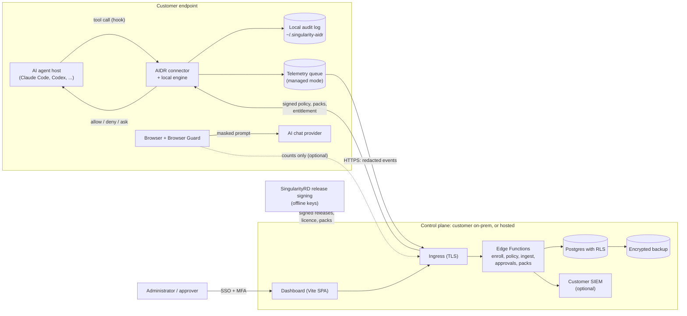
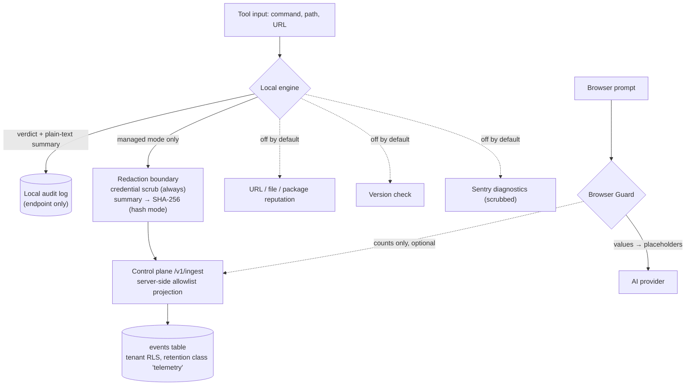

# Singularity AIDR security whitepaper

> **DRAFT — business and security review required before external use.**
> This whitepaper describes the implemented design in this repository. It is
> not an attestation, certification or audit report: Singularity AIDR has **no
> SOC 2 report, no ISO 27001 certification and no completed independent
> penetration test** ([pentest scope/RFP](pentest-scope-rfp.md)). Where a
> control depends on deployment evidence that does not exist yet, this paper
> says so. Version: draft 0.1, 14 October 2026. Data flows are derived from the
> [data-flow and privacy register](../production-readiness/data-flow-privacy-v6.md).

## 1. What the product does

Singularity AIDR is a detection and response layer for AI agents. It sits at
the hook boundary of AI coding agents (Claude Code, OpenCode, OpenClaw,
Cursor / VS Code as a preview — no real-host acceptance evidence yet, and Codex
CLI as a preview outside the first GA scope) and in the browser (Browser Guard), and decides for each command, file
access and web request whether to `allow`, `deny` or `ask` (block pending
out-of-band human approval). An MCP gateway inspects MCP tool results before
they reach the model.

Three properties drive the security design:

1. **Local by default.** The detection engine runs on the endpoint against
   bundled rules. A fresh install needs no account and sends nothing. The
   control plane is an opt-in managed layer, and an unreachable or un-enrolled
   control plane switches managed features off, never local detection.
2. **Data stays where the customer puts it.** The control plane can run fully
   on the customer's infrastructure, including air-gapped networks; then no
   telemetry reaches SingularityRD.
3. **Approvals are never agent-callable.** No connector exposes an approval
   tool to the agent; a prompt-injected agent cannot approve its own block.

## 2. Architecture

| Component | Runs where | Trust notes |
|---|---|---|
| Connectors + local engine | Endpoint, in the agent host's hook process | Verifies its own release signature before starting (commercial builds); rules are data (YAML), not code |
| Browser Guard | Browser extension (Chrome, Edge, Firefox) | Placeholder ↔ value map stays in the browser: tab memory plus memory-backed `chrome.storage.session` (trusted extension contexts only; removed on tab close or after 4 h idle); never written to disk storage or sent |
| MCP gateway | Endpoint loopback (HTTP + stdio bridge) | Signed manifests; approval is an operator command, never an MCP tool |
| Control plane | Customer host (Docker Compose / Helm) or SingularityRD-hosted (not live yet) | Supabase stack (Postgres, Auth, Storage, Edge Functions) + dashboard; services bind to loopback behind the customer's TLS ingress |
| Release and licence signing | SingularityRD, offline | Ed25519; private keys never on endpoints or customer servers |

## 3. Data flow

The register lists every principal flow with its source path; this is the
customer-facing summary. "Off" means off unless an administrator enables it.

| Flow | Default | Leaves the endpoint | Contains personal data |
|---|---|---|---|
| Local detection and audit | On | No | Yes (local log is plain text) |
| Managed telemetry | Off (managed mode + enrollment) | To the chosen control plane | Identifiers, verdicts; summaries and artefacts as SHA-256 digests by default |
| Browser Guard telemetry | Off (needs URL + key) | To the chosen control plane | Counts per type only; no prompt text, values or page URLs |
| URL / file / package reputation | Off | To the configured endpoint | URL (may contain personal data), hashes, package names |
| Version check | Off | To the version endpoint | Version, OS, random installation ID |
| Diagnostics (Sentry) | Off (explicit opt-in + DSN) | To the configured Sentry project | Scrubbed error metadata |
| Support bundle | Only on an approved case | Through the agreed channel | Designed to exclude it (allowlisted summary) |
| SIEM delivery | Off | To the customer SIEM | Same fields as stored events |

**Not sent anywhere by AIDR:** source code, file contents, full prompts, and
the values Browser Guard masked.

## 4. Controls

### Identity and access

- Dashboard sign-in with SAML 2.0 or OIDC (Microsoft Entra ID, Okta, generic
  OIDC), SCIM provisioning, MFA and recovery codes for local accounts. OIDC
  sign-in currently expects users provisioned in advance (by SCIM); live
  acceptance with the customer's IdP is a per-deployment step.
- Roles: owner, admin, member, viewer; role changes are audited.
- Device enrollment by short-lived device codes or an enrollment token; the
  device receives a configuration bound to its tenant. Tenant API keys are
  stored as hashes only.

### Tenant isolation

- Row-level security on every tenant table (`app.is_tenant_member`) and
  role-aware policies; anonymous users have no write access.
- Cross-tenant negative tests run against Postgres in the repository. A live
  two-tenant test on an accepted deployment is still open.

### Integrity and signing

- Ed25519 signatures on release artefact manifests, the customer-delivery
  envelope, runtime policy, tenant detector bundles, rule and intel packs, the
  offline licence and (optionally) every local audit record (SHA-256 hash
  chain with a signed head).
- Verification is done by the receiving side with independently delivered
  public keys; an unsigned, tampered, wrong-signer, expired or rolled-back
  artefact is rejected.
- Production signing keys must be generated and held by people under a
  documented ceremony; this has not happened yet (the shipped licence key
  registry is empty).

### Failure behaviour (per layer)

- Connector entry points fail closed: on an internal error Claude Code,
  OpenClaw, OpenCode, Codex and the Cursor / VS Code hook return a deny. The
  host still has the last word: a hook the host disabled, did not trust,
  killed or timed out gives no answer, and Codex documents that it proceeds in
  that case.
- Detection internals skip a failing signal, log it and continue; a skipped
  signal is never reported as clean.
- Security controls (authentication, tenant isolation, rate limits, webhook
  signatures, approvals) fail closed.
- Managed features stop when the licence lapses; local detection does not.

### Transport and storage

- HTTPS/TLS between endpoints, browsers and the control plane. On-prem, TLS
  terminates at the customer's ingress (public CA via ACME or customer-supplied
  certificates from an internal CA).
- Disk encryption is provided by the hosting environment (customer volumes
  on-prem; the provider for hosted, to be confirmed per region).
- Backups are encrypted, copied offsite and restore-drilled with the shipped
  tooling; restore evidence is per deployment.

### Logging and audit

- Endpoint: JSONL audit log with size-based rotation; optional signed chain.
- Control plane: administrative actions, enrollment, invitations, role and
  policy changes, installer downloads and approvals are recorded; audit export
  (JSONL/CSV) and SIEM delivery in the `aidr.siem.event/v1` schema.

### Retention and deletion

- Per-tenant retention per data class with platform floors (for example
  security audit at least 365 days), legal holds, and recorded deletion on
  tenant offboarding. Details: [KVKK guide](../operations/kvkk.md).

### Secure development and supply chain

- Code review, automated unit, integration and real-host tests, secret
  scanning, dependency audit, SBOM generation and build provenance
  attestation for release artefacts.
- Container images are scanned; open findings are tracked in
  `READINESS_BACKLOG.json` and are not hidden.

## 5. What is not in place

Stated plainly so that a reviewer does not have to find it:

- No independent penetration test, SOC 2 or ISO 27001.
- No staffed on-call rota or approved SLA ([support process](../runbooks/support-process.md)).
- No monitored external vulnerability-reporting route yet
  ([disclosure policy draft](vulnerability-disclosure-policy.md)).
- No hosted service is live: the app hostname does not resolve and no EU, US or
  APAC region is deployed; hosted region and subprocessors are not verified
  ([data residency](../deployment/data-residency.md)).
- Real-host evidence only on Linux x64 for four connectors; none for Cursor /
  VS Code ([compatibility matrix](../compatibility-matrix.md)). Codex CLI is a
  preview outside the five-connector first GA scope.
- Browser Guard is verified against fixture copies of the AI sites only, not the
  live sites, and is not yet published in the Chrome, Edge or Firefox stores.
- No AIDR desktop application exists; endpoints run the CLI, hooks and extensions.
- Windows code-signing certificate and production signing keys are not yet
  held.

## 6. Related documents

- [Security FAQ](../sales/security-faq.md) ([Türkçe](../sales/security-faq.tr.md))
- [Privacy and telemetry](../privacy.md) ([Türkçe](../privacy.tr.md))
- [Data Processing Agreement draft](../legal/dpa.en.md) with TOMs annex
- [Supported versions policy draft](supported-versions.md)
- [Source-code escrow offer template](../legal/kaynak-kod-emaneti-teklif.md)
